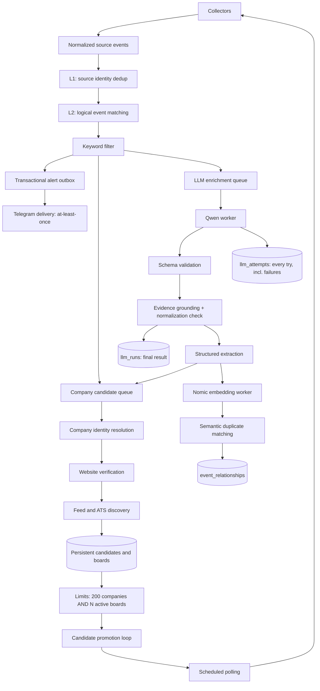

# Architecture revision plan (before Phase 7)

Status: IMPLEMENTED (uncommitted at time of writing), migration `0004`. Decisions: board cap 300, suppress confirmed duplicates, keep the 0.95 gate. Unverified LLM/regex facts are staged as claims, never written to funding_rounds, company_investors or founders (Phase 7 verifies). Gate result: accuracy 0.96 on the 69-event gold set. Plan basis: review notes A-F plus the code at `0d48b5f`.

## Target flow

## What already exists (do not rebuild)

| Item | State today |
|---|---|
| L1 dedup | `source_events` unique on (source, source_event_id) and on canonical URL. Works. |
| Outbox | `alert_deliveries`: unique (channel, dedup_key), leases, attempts, backoff, `dead` state. Already at-least-once. |
| `process_event` retry | Alert insert is `ON CONFLICT DO NOTHING`, so a retry does not create a second alert. |
| Cap | 200 *companies* (`companies.watched`). Over cap: board stored as `candidate`, route disabled. Nothing ever promotes it. |

## Changes

### 1. L2 logical event matching (your Level 2; new step D)
Today the only semantic dedup runs inside the LLM job, after the alert has gone out, and only marks `duplicate_of`.
- New table `event_relationships(event_id, related_event_id, kind, score, method, created_at)`; `kind` in `same_event | syndicated_copy | follow_up`; unique pair.
- Two stages, both writing relationships:
  1. **Cheap, synchronous (in `process_event`)**: same canonical company + same amount within 7 days, or identical `content_hash` across sources -> `same_event`. No LLM needed.
  2. **Semantic, async (after embedding)**: cosine >= 0.92 within 14 days -> `same_event`. Replaces `event_embeddings.duplicate_of`, which is dropped in the migration.
- Alert policy: first event of a group alerts; later members are linked, not alerted (replaces the `event:{content_hash}` dedup key as the group key). Phase 7 reads these links for "syndicated copies are not independent corroboration".
- Files: new `services/dedup.py`; edit `pipeline.py`, `llm.py`; migration `0004`.

### 2. B: grounding with normalized values
Literal matching nulls legitimate normalizations ("$5M" -> 5000000, "Zypto Labs Pvt Ltd" -> "Zypto").
- LLM schema changes from `field: value` to `field: {value, evidence}` where `evidence` is a verbatim quote from the article. Add `founders` and `round` (stage) to the schema; amounts get `{value, currency}`.
- Validation per field, in order: (1) quote is in the source (case/whitespace/quote-mark normalized); (2) value is supported by the quote; (3) normalization is valid; (4) otherwise the field becomes null.
- Steps 2 and 3 are **deterministic code, not the model**: amount parser (`$5M`, `5 million`, `Rs 40 Cr`, EUR) must equal the claimed number; company compared via `canonical()`; stage via a fixed alias map; investors/founders must appear in the quote.
- Store per-field outcome (`supported | normalized | rejected`) so Phase 7 can weight evidence.
- Risk: asking for quotes lengthens output (roughly +30-60 tokens per field), so expect 5-8 s per item on this CPU. Re-run the gold benchmark; accept only if accuracy stays >= 0.95.
- Files: `services/llm.py` (rewrite `ground`), new `services/normalize.py`, tests.

### 3. C: two independent limits and promotion
- Meaning fixed: **`AUTO_WATCH_COMPANY_CAP=200`** (companies auto-added) and **`AUTO_BOARD_CAP`** (active auto-registered ATS boards). One company may have several boards; each limit is checked separately. Recommended default board cap: 300 (your pick).
- Seed boards from `sources.yaml` (the 30 accepted tokens) are exempt from both caps.
- Promotion loop (hourly): when room exists, rank `candidate` boards by: hot (funded <= 90 d) > India-linked > oldest candidate (an unpolled board has no job events to rank by); enable the top ones; set status `active`, `promoted_at`, `promotion_reason`. Demotion: a board with 0 jobs for 60 days or 3 consecutive failures goes back to `candidate`, freeing room.
- Files: `services/ats.py` (`register_board` stops deciding; new `promote_candidates`), `core/config.py`, worker maintenance loop.

### 4. D: persistence path for every discovery
`ats_boards` today has provider, token, URL, company, status, `discovered_via`. `last_polled_at` and `last_success_at` exist but **nothing writes them**.
- Add to `ats_boards`: `evidence jsonb` (page where found, matched href, method), `verification_status` (`unverified | verified | failed`), `verified_at`, `last_job_count`, `next_poll_at`, `promoted_at`, `promotion_reason`.
- `run_once` (connectors/runner.py) updates `last_polled_at`, `last_success_at`, `next_poll_at = now + poll_interval` for ATS routes (hook keyed on `config.kind == 'ats'`).
- Common Crawl candidates are stored `unverified`; verification happens at promotion time, not at seeding.
- Same fields for `company_sources` (feeds): add `verified_at`, `last_polled_at`, `next_poll_at` populated from the linked route's runs.
- Files: migration `0004`, `ats.py`, `runner.py`, `discovery.py`.

### 5. E: explicit outbox semantics
The outbox already gives at-least-once with stable IDs. The remaining gap: Telegram accepts, worker dies before `mark_sent`, lease expires, the alert is re-sent.
- Document the contract: **at-least-once, with duplicate suppression by `(channel, dedup_key)` before send; resends after a crash are marked, not hidden**.
- When `claim_pending` re-claims a row that was `sending` (lease expired), set `possible_duplicate=true`; `format_alert` appends "(resent)" so a duplicate is recognizable instead of silent.
- Telegram offers no idempotency key, so exactly-once is not claimed anywhere.
- Make `add_candidate` idempotent per `source_event_id` (unique index) so a retried `process_event` cannot queue a second candidate after the first was accepted. `process_event` already writes the label and alert idempotently.
- Files: `outbox.py`, `pipeline.py` (`format_alert`), `companies.py`, migration `0004`.

### 6. F: record failed LLM attempts
Today a transport error (timeout, server down) records nothing, and `ON CONFLICT DO NOTHING` on `llm_runs` hides re-runs.
- New table `llm_attempts(id, source_event_id, task, model, attempt_no, outcome, raw_output (truncated to 2 KB), error, latency_ms, prompt_tokens, completion_tokens, created_at)`; `outcome` in `ok | invalid_json | schema_error | grounding_empty | timeout | http_error`.
- `extract()` returns every attempt, the worker writes them all, including when the call raises. `llm_runs` stays the single final record per (event, task) and gains `attempt_count`.
- `/api/llm-metrics` adds failure breakdown by `outcome` and timeouts.
- Files: `llm.py`, `worker.py` (`llm_jobs`), `dashboard.py`, migration `0004`.

## Order of work
1. Migration `0004` (all schema changes together) + model updates.
2. F (attempts): small, and it lets us measure B.
3. B (grounding), then re-run `scripts/llm_benchmark.py`; gate on accuracy >= 0.95.
4. D, then C (persistence first, promotion needs it).
5. L2 matching.
6. E (outbox marker, candidate idempotency).
Each step ships with tests; the backend suite stays green at every step.

## Open decisions for you
1. Board cap number (recommend 300 active auto boards).
2. Alert policy for same-event duplicates: suppress later alerts (recommended) or send them marked "also reported by X"?
3. B accuracy gate: keep 0.95, or accept a drop for richer fields?
